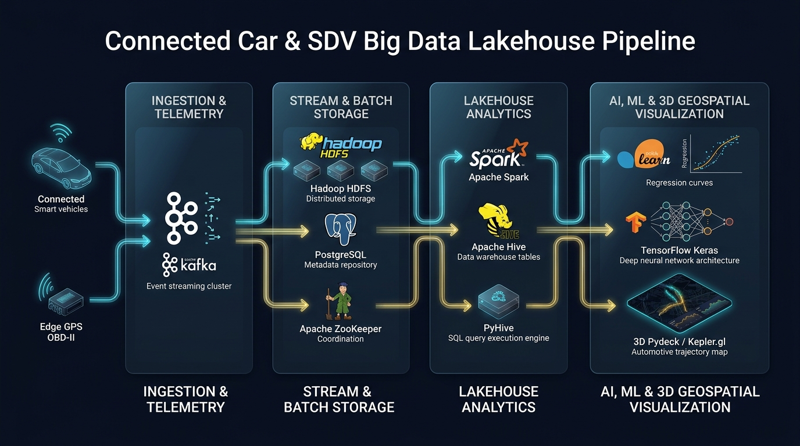
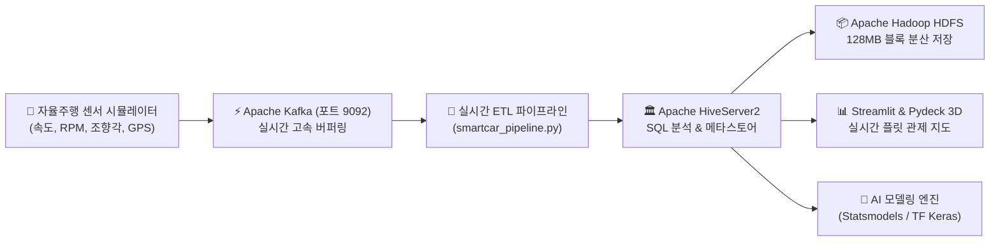

# 🚗 자율주행 AI 자동차 빅데이터 레이크하우스 실습 킷 (SDV Lakehouse Lab)

[](https://www.docker.com/)
[](https://hadoop.apache.org/)
[](https://kafka.apache.org/)
[](https://hive.apache.org/)
[](https://www.python.org/)
[](https://www.tensorflow.org/)

본 저장소는 도서 **《자율주행 AI 자동차 빅데이터 레이크하우스 실무 가이드》** 독자들을 위한 **공식 실습 환경 구성 파일, 파이프라인 엔진 코드, 실습 데이터셋 저장소**입니다.

> 🔒 **[저작권 및 도서 이용 안내]**  
> 본 공개 저장소는 독자의 원활한 실습을 위한 **데이터셋(`data/`)** 및 **도커/파이썬 실행 스크립트**만을 제공합니다.  
> 14개 정규 챕터의 상세 해설, 비유, 아키텍처 원리, 트러블슈팅 가이드 등 도서의 모든 본문 저작물은 **[위키독스 공식 도서(Book 22015)](https://wikidocs.net/book/22015)**를 통해서만 정식 서비스됩니다.

---

> ### 🎮 [DMDG 시그니처] 1초 실행 실시간 웹 인터랙티브 시뮬레이터 탑재
> 
> 복잡한 환경을 설치하기 전, 10대 자율주행 차량의 센서 스트림, 카프카 브로커, HDFS 128MB 블록 3벌 복제, Hive SQL 쿼리, 딥러닝 사고 예측을 웹 브라우저에서 1초 만에 직접 조작해 보세요!
> 
> [-00f2fe?style=for-the-badge&logoColor=000)](https://htmlpreview.github.io/?https://github.com/freefluxkr/smartcar-lakehouse/blob/main/sim_autonomous_car_lakehouse.html) &nbsp; [-f59e0b?style=for-the-badge)](https://wikidocs.net/book/22015)
> 
> *(로컬 저장소의 `sim_autonomous_car_lakehouse.html` 파일을 더블 클릭하여 크롬 브라우저로도 즉시 오프라인 구동 가능합니다.)*

---

## 🏛️ 1. 빅데이터 & AI 파이프라인 아키텍처

자율주행 차량의 실시간 센서 패킷 수집부터 분산 저장, SQL 쿼리 탐색, 3차원 지도 시각화, 심층 인공지능 예측까지 원클릭으로 구동됩니다.





---

## 📊 2. 실습 데이터셋 및 컬럼 명세서 (Data Dictionary)

데이터셋은 [`data/`](./data) 디렉터리에 위치하며, `download_dataset.py`를 통해 원클릭 동기화할 수 있습니다.  
자세한 세부 코드는 [data/README.md](./data/README.md)를 참고하세요.

### 2.1 차량 제원 기반 고객 소득 예측 데이터 (`CarMaster2Income.txt`)
* **목적**: 차량 배기량 및 고객 제원을 활용한 OLS 다중 선형 회귀분석 ($R^2$, p-value 검정)
* **포맷**: 파이프(`|`) 구분 텍스트

| 컬럼명 | 타입 | 설명 | 예시 |
| :--- | :---: | :--- | :--- |
| `carNum` | String | 차량 관리 일련번호 (PK) | `A0001` |
| `sex` | String | 소유주 성별 (`남`, `여`) | `남` |
| `age` | Integer | 소유주 연령 (만 나이) | `34` |
| `marriage` | String | 소유주 기혼 여부 (`미혼`, `기혼`) | `기혼` |
| `region` | String | 소유주 거주 지역 광역단체 | `경기` |
| `job` | String | 소유주 직업군 (회사원, 전문직, 주부 등) | `회사원` |
| `capacity` | Integer | 차량 배기량 (cc 단위) | `3000` |
| `year` | Integer | 차량 제작 연식 (출고 연도) | `2015` |
| `type` | String | 차종 세그먼트 등급 코드 (`A`~`H`) | `B` |
| **`income`** | Integer | **🎯 소유주 연소득 (만원 단위, 예측 Target)** | `4400` |

---

### 2.2 주행 사고 센서 특성 데이터 (`CarDrivingIncidentInfo.csv`)
* **목적**: 10대 센서/환경 특성을 학습하여 사고 부위를 예측하는 3-Class 심층 신경망(DNN) 분류
* **포맷**: CSV (20만 행 대용량)

| 컬럼 약칭 | 정식 영문명 | 설명 및 코드값 범위 |
| :--- | :--- | :--- |
| **`wea`** | Weather | 기상 상태 (`0`: 맑음, `1`: 흐림, `2`: 비, `3`: 눈) |
| **`temp`** | Temperature | 기온 구간 (`0`: 영하, `1`: 상온, `2`: 혹서기) |
| **`hum`** | Humidity | 습도 구간 (`0`: 건조, `1`: 보통, `2`: 다습) |
| **`arrCar`** | Surrounding Vehicles | 주변 차량 밀집도 (`0`: 한산, `1`: 보통, `2`: 혼잡) |
| **`timeSlot`** | Time Slot | 주행 시간대 (`0`: 심야, `1`: 주간, `2`: 출퇴근 피크) |
| **`acciArea`** | Accident Area | 도로 유형 (`0`: 직선, `1`: 급커브, `2`: 교차로, `3`: 고속도로) |
| **`drvCond`** | Driver Condition | 운전자 상태 (`0`: 정상, `1`: 주의산만, `2`: 졸음) |
| **`innCond`** | Interior Condition | 차내 캐빈 상태 (`0`: 정숙, `1`: 보통, `2`: 경고음) |
| **`carSpd`** | Vehicle Speed | 차량 주행 속도 (`0`: 저속, `1`: 중속, `2`: 고속) |
| **`steeAng`** | Steering Angle | 핸들 조향각 급변 (`0`: 직진, `1`: 차선변경, `2`: 급조향) |
| **`acciPos`** | **Accident Position** | **🎯 사고 충돌 부위 (`0`: 전방, `1`: 측면, `2`: 후방)** |

---

## 🚀 3. 빠른 시작 가이드 (Quick Start)

### 3.1 빅데이터 8대 컨테이너 기동
```bash
docker compose up -d
docker compose ps
```

### 3.2 파이썬 가상환경 준비 (Poetry)
```bash
poetry install
```

### 3.3 실습 데이터셋 동기화
```bash
poetry run python download_dataset.py
```

### 3.4 실시간 파이프라인 및 AI 모델링 테스트
```bash
# 1. Hive 연동 테스트
poetry run python smartcar_hive_test.py

# 2. 카프카 연동 테스트
poetry run python smartcar_kafka_test.py

# 3. 소득 예측 다중 회귀분석 실행
poetry run python smartcar_regression.py

# 4. 주행 사고 패턴 3-Class 심층 신경망(DNN) 분류기 실행
poetry run python smartcar_dnn_classifier.py
```

---

## 📄 저작권 및 라이선스 (License)
* 본 저장소의 실습 코드 및 데이터셋은 **Apache-2.0 License**를 따릅니다.
* 도서의 모든 본문 텍스트, 설명, 해설, 교육 저작권은 **DMDG 출판부**에 귀속되어 있으며 무단 복제 및 2차 배포를 엄격히 금합니다.
